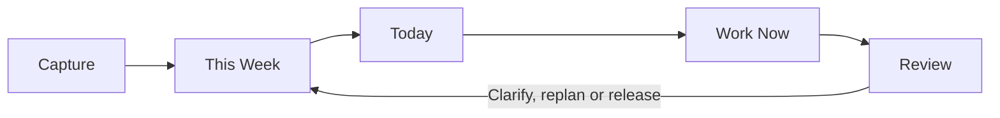
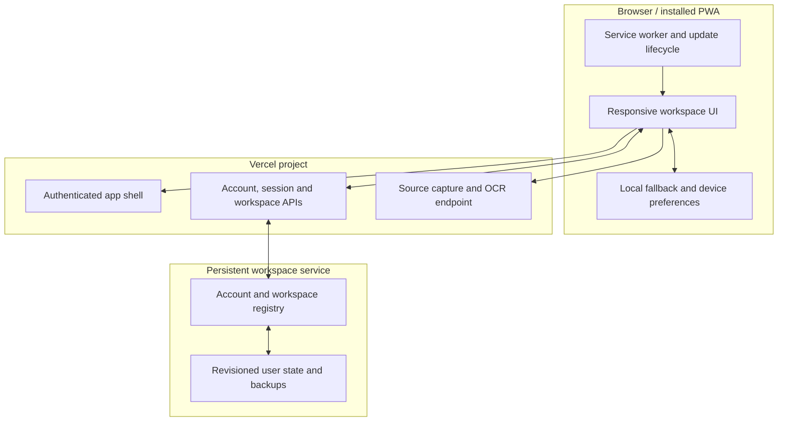
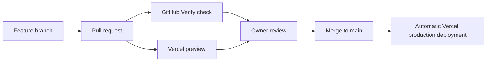

# Life Command Center

> A personal command center for seeing everything, choosing what matters, and preventing commitments from disappearing.

[](https://github.com/devyflow/life-command-center/actions/workflows/ci.yml)


**Live prototype:** [dvlife.vercel.app](https://dvlife.vercel.app/)
**Current release stage:** Private V1 release candidate

Life Command Center combines fast capture, daily execution, hourly planning and flexible visual thinking in one synchronized workspace. It is designed for people whose personal and professional commitments are scattered across notes, calendars, screenshots, chats and memory.

## Product promise

**Nothing important should disappear simply because it is not scheduled yet.**

The product follows one deliberate loop:



- **Capture** without organizing everything immediately.
- **This Week** keeps near-term commitments visible.
- **Today** makes a conscious daily selection.
- **Work Now** starts the next useful action with a focus timer.
- **Review** recovers unclear and repeatedly postponed tasks without punishment.

## What makes it different

Most productivity tools force users to choose between structured task management and the freedom of paper. Life Command Center keeps both views synchronized.

| Capability | What it solves |
| --- | --- |
| Title-only quick capture | Removes the friction that causes people to postpone recording a task |
| Today command view | Shows the recommended next action, scheduled work, risks and loose commitments |
| This Week signal and queue | Keeps important near-term work visible without forcing an exact day too early |
| Hour planner | Plans every hour while preserving free time and flexible windows |
| Progress with a safety lock | Records partial progress without accidental slider movement |
| Completion confirmation and recovery | Prevents accidental completion and preserves an auditable history |
| Paper page | Displays structured tasks as a movable, drawable one-page workspace |
| Bulletin board | Keeps thoughts, principles, decisions and quotes visible like physical sticky notes |
| Useful Library | Stores tools, books, links and posts and quietly suggests them beside relevant tasks |
| OCR page capture | Converts a photographed or uploaded page into editable tasks and notes |
| Time requests | Lets another person request time without exposing private task details |
| Non-punitive momentum | Rewards useful progress while allowing rest and deliberate replanning |

## Task signals

Signals express different decisions instead of acting as duplicate priority labels.

| Signal | Meaning |
| --- | --- |
| ◯ **Important** | Ignoring this task has meaningful consequences |
| ◆ **This week** | This task deserves attention during the current week |
| ★ **Today focus** | This task was deliberately selected for today |
| ✓ **Ready to act** | The next physical action is understood |
| □ **Protected time** | Its scheduled time should be defended |

Signals remain synchronized across Tasks and Paper and can be used as filters.

## Main product areas

### Today

The default command view contains title-only capture, the daily workflow, workload metrics, the next recommended task, at-risk commitments, unscheduled work and the weekly queue.

### Hour planner

Tasks can be assigned to exact times, dragged between hours, or kept inside a flexible time window until the user is ready to choose. Free-time blocks and pending external requests remain visible beside planned work.

### Paper

Paper provides an editable one-page representation of the same task data. Tasks automatically appear under category and subcategory headings. Marks, progress and completion remain bidirectional. The canvas opens locked so touch scrolling and zooming cannot move objects accidentally.

### Bulletin

The board supports sticky-note thoughts, quotations and decisions with safe placement, optional floating overlap, position locking, sizing, rotation and app-wide glance reminders.

### Useful Library

The library stores material that people commonly save and forget: websites, tools, books, posts and videos. Matching uses task context to offer quiet suggestions without interrupting the main workflow.

### Page and source capture

Users can scan a physical page or upload an image for OCR review. Detected regions remain editable before import. Links and images can also produce suggested tasks, but nothing is added until the user chooses it.

## Architecture



The client is framework-free HTML, CSS and JavaScript. Vercel Functions provide authentication, account isolation, session management, workspace synchronization and source capture. State writes use revisions so conflicting updates can be detected rather than silently overwriting newer work.

## Repository structure

```text
api/                    Vercel Functions for auth, accounts, state and capture
client/                 PWA interface, styles, service worker and icons
drizzle/                Persistent-state schema
scripts/                Build, validation and isolated QA scripts
worker/                 Alternative authenticated Worker runtime
.github/workflows/      Pull-request and main-branch verification
docs/                   Release and operational documentation
vercel.json             Production build, routing and security headers
```

Generated folders such as `public/`, `dist/`, `.vercel/` and `node_modules/` are intentionally excluded from version control.

## Local development

### Requirements

- Node.js 24
- npm
- Vercel CLI through the project development dependency
- Private development environment values supplied outside Git

### Install and verify

```bash
npm ci
npm run check
npx vercel dev
```

### Environment variables

Create `.env.local` locally. Never commit it.

| Variable | Required | Purpose |
| --- | --- | --- |
| `ACCESS_SECRET` | Yes | Signs sessions and protects access to the private workspace service |
| `UPSTREAM_URL` | Deployment-dependent | Overrides the configured persistent workspace service |

Use a long random production secret. Do not reuse a personal password.

## Commands

| Command | Purpose |
| --- | --- |
| `npm test` | Runs workspace, Vercel and experience validations |
| `npm run check` | Runs all tests and creates the Vercel production build |
| `npm run validate` | Validates Worker authentication, persistence and revision handling |
| `npm run validate:vercel` | Validates account isolation, sessions, sync, scanner and PWA behavior |
| `npm run test:experience` | Exercises task, Paper, Bulletin, Library and interface state transitions |
| `npm run build:vercel` | Builds deployable assets into `public/` |
| `npm run preview:qa` | Starts a loopback-only disposable QA workspace |

Tests use disposable state and do not contact the live user workspace.

## Data and synchronization

- Each account has a separate workspace identifier.
- Session cookies are signed and support remembered sessions.
- Workspace writes carry a base revision to detect concurrent changes.
- Limited backups and completion history support recovery.
- Device-only preferences include interface accent and canvas zoom.
- The installed PWA caches the application shell while workspace data continues through authenticated synchronization.

## Security and privacy

- Never commit passwords, `.env.local`, tokens, recovery codes, workspace exports or private calendar links.
- Pull requests should use test fixtures rather than real personal information.
- Support or owner access must be disclosed to the affected user before public release.
- Public time sharing exposes only the labels deliberately selected for sharing.
- Report sensitive problems privately as described in [SECURITY.md](SECURITY.md).

## Collaboration and deployment

`main` is the production branch.



Recommended repository rules:

1. Require a pull request before merging into `main`.
2. Require at least one approval.
3. Require the **Verify** status check.
4. Block force pushes and branch deletion on `main`.
5. Review the Vercel preview on desktop and mobile before merge.

Read [CONTRIBUTING.md](CONTRIBUTING.md) before submitting changes.

## V1 release criteria

The project remains at `0.9.0` until the following are verified:

- New users understand the daily path without explanation.
- Core task flows work on desktop and an installed mobile PWA.
- Account isolation, recovery, export and conflict behavior are tested.
- OCR correction is faster than manual re-entry for representative pages.
- A teammate pull request passes CI, receives a preview and deploys after merge.
- Five external testers use real tasks for seven days.

The complete checklist is in [docs/V1_RELEASE_CHECKLIST.md](docs/V1_RELEASE_CHECKLIST.md).

## Roadmap after V1

- Reliable workspace export and restore
- Stronger multi-device conflict recovery
- Calendar integrations after the core web workflow is stable
- Improved handwriting and page-region OCR
- Optional contextual assistance for planning and knowledge retrieval
- Windows and mobile clients sharing the same account and workspace model

## License

This repository is currently private and no open-source license has been applied. All rights remain reserved while the product and commercial model are finalized.

If the project is intentionally opened later, the license decision must be made before changing repository visibility.

